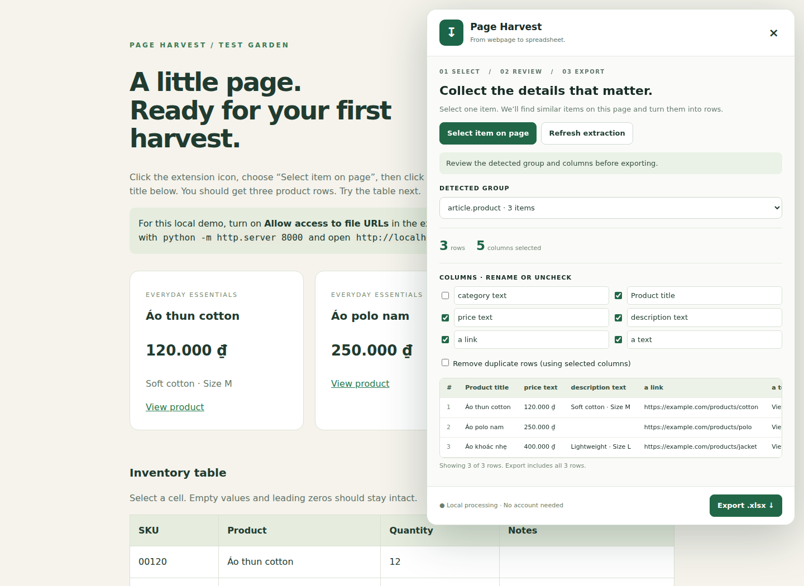
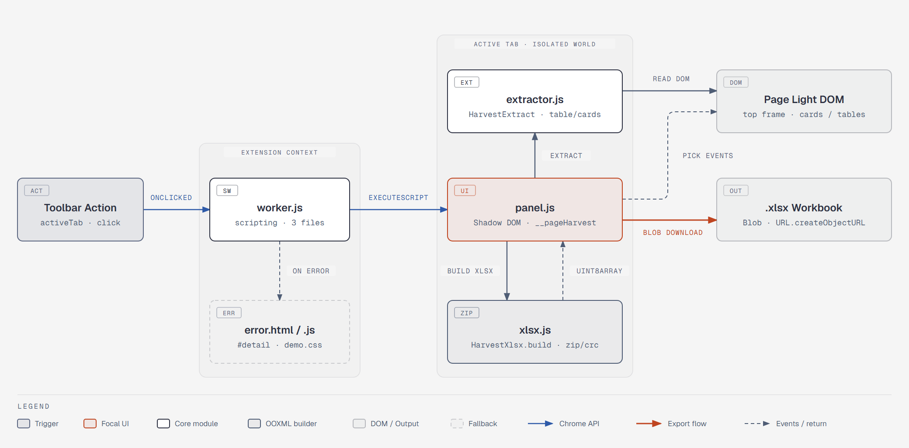

# Page Harvest — Website to Excel


A dependency-free Chrome/Edge extension: select a repeated website item, review the extracted rows, and download a real `.xlsx` workbook. Processing happens locally in the tab. No API key, server, or account required.



## Install on Windows

### From a release archive (`page-harvest.zip`)

1. Right-click `page-harvest.zip` → **Extract All**. Keep the extracted folder in a permanent location, for example `C:\dev\page-harvest`.
2. In Chrome, open `chrome://extensions`. In Edge, open `edge://extensions`.
3. Turn on **Developer mode**.
4. Click **Load unpacked** and select the inner `page-harvest` folder that directly contains `manifest.json`.
5. Pin **Page Harvest — Website to Excel** from the browser’s Extensions menu.

### From this repository

1. Clone or download this repository to a permanent local folder.
2. Open `chrome://extensions` (Chrome) or `edge://extensions` (Edge) and turn on **Developer mode**.
3. Click **Load unpacked** and select this repository root directory (the folder containing `manifest.json`).
4. Pin **Page Harvest — Website to Excel** from the browser’s Extensions menu.

This is an unpacked extension, not a Chrome Web Store listing. It requires no build step or `npm install` to use.

## Extract data

1. Open your target website. Wait for the content to load.
2. Click the Page Harvest toolbar icon.
3. Click **Select item on page**, then click a product title, article, list item, or table cell. Press **Esc** to cancel selection.
4. Choose the desired **Detected group** if several groups are offered. The detector looks for repeated siblings at different ancestor levels.
5. Check the preview. Rename columns and uncheck unwanted columns. Enable **Remove duplicate rows** if needed.
6. Click **Export .xlsx**. The browser downloads the file using its normal download settings.

The preview displays up to 50 rows; export includes all detected rows up to the 5,000-row limit. All values are exported as text, so product codes such as `00120` retain their zeros. Formula-like text is not executed as a formula. Convert numeric columns in Excel if you need calculations.

**Refresh extraction** rereads the selected group after new content is loaded. It resets column names and selections. Scroll or click the website’s Load more button yourself before refreshing. If the site replaces the selected element, select an item again. A page reload or navigation discards the current selection and preview.

## Try the demo

Open `demo.html`. On the extension’s Details page, enable **Allow access to file URLs** to let it read local HTML. Select a product title: expect three rows, including a blank description for the polo product. Select an inventory cell: expect three rows and four columns, preserving SKU zeros.

Alternatively, run `python -m http.server 8000` in this folder and visit `http://localhost:8000/demo.html`.

## Architecture & Component Flow

Page Harvest has zero build steps and zero runtime dependencies. Clicking the toolbar icon triggers `worker.js` via `activeTab` and injects `extractor.js`, `xlsx.js`, and `panel.js` into the active tab’s isolated content-script world using `chrome.scripting.executeScript`. If injection fails (for example on browser settings pages or `file://` without permission), `worker.js` opens `error.html` with the encoded error message in the URL fragment.



[Open interactive HTML diagram (`docs/diagrams/architecture.html`)](docs/diagrams/architecture.html)

## Extraction & Export Lifecycle


[Open interactive HTML diagram (`docs/diagrams/extraction-lifecycle.html`)](docs/diagrams/extraction-lifecycle.html)

## Project structure

```text
page-harvest/
├── manifest.json             # MV3 config (activeTab, scripting, Chrome 111+)
├── worker.js                 # Service worker: toolbar click injection & error fallback
├── extractor.js              # HarvestExtract: repeating group detection & field alignment
├── panel.js                  # Closed Shadow DOM UI, hover picker, preview & Blob export
├── xlsx.js                   # HarvestXlsx: dependency-free ZIP (STORE) + OOXML writer
├── error.html                # Fallback help page when a tab cannot be read
├── error.js                  # Writes decoded location.hash error detail into #detail
├── demo.html                 # Local test page (product cards + inventory table)
├── demo.css                  # Shared stylesheet for demo.html and error.html
├── package.json              # Test runner scripts and Playwright devDependency
├── icons/
│   ├── 16.png
│   ├── 48.png
│   └── 128.png
├── docs/
│   ├── design.md             # Product & architecture specification
│   ├── plan.md               # Implementation plan
│   ├── preview.png           # Browser-captured panel preview
│   └── diagrams/
│       ├── architecture.html         # Interactive component architecture diagram
│       ├── architecture.png          # Rendered 2x PNG embedded in README
│       ├── extraction-lifecycle.html # Interactive extraction & export sequence diagram
│       └── extraction-lifecycle.png  # Rendered 2x PNG embedded in README
└── tests/
    ├── xlsx.cjs              # Standalone Node test for HarvestXlsx.build()
    ├── p0.test.cjs           # Zero-dependency Node regression suite (P0-1..P0-8)
    ├── test.cjs              # Playwright tests for HarvestExtract & HarvestXlsx
    ├── ui.cjs                # Playwright end-to-end UI flow against demo.html
    └── verify_workbooks.py   # Independent Python openpyxl workbook verification
```

| File | Purpose |
| --- | --- |
| `manifest.json`, `worker.js` | Extension configuration and user-triggered injection |
| `extractor.js` | Repeated group detection (`HarvestExtract.candidates`) and field alignment (`HarvestExtract.extract`) |
| `panel.js` | Isolated closed Shadow DOM selection/preview interface (`__pageHarvest`) and Blob download |
| `xlsx.js` | Dependency-free ZIP/OOXML export (`HarvestXlsx.build`) |
| `demo.html`, `demo.css` | Local test page and shared stylesheet |
| `error.html`, `error.js` | Help page when a page cannot be accessed |
| `docs/diagrams/` | Editorial HTML/SVG architecture & lifecycle diagrams and 2x PNG exports |
| `tests/` | Extraction, UI, and openpyxl workbook checks |

## What it supports

- Repeating sibling cards/list items with similar HTML structures.
- Text, supported link URLs (`http:`, `https:`, `mailto:`, `tel:`), image URLs (`http:`, `https:`, `file:`), and image alt text. Image files themselves are not downloaded.
- HTML tables, including empty cells and common merged-cell (`colSpan`/`rowSpan`) layouts.
- Column inclusion/renaming, group selection, duplicate removal, and refresh.
- UTF-8/Unicode Excel output, frozen header row, and auto-filters.

## Limits

- **Current page only.** No automatic pagination, whole-site crawl, or scheduled extraction.
- Only elements present in the current top-level page DOM. Virtualized lists may remove earlier rows while you scroll; those removed rows cannot be recovered by refreshing.
- No iframe content, shadow-root content, PDF/image OCR, browser settings pages, or extension-store pages.
- Matching is based on HTML structure, not semantic AI. Unusual layouts, changing class names, or inconsistent markup can produce extra/misaligned columns. Review the preview and try a different group. This is not guaranteed to work with every website.
- Maximum 5,000 rows, 100 columns, and 2,000 visited elements per card. Cells exceeding Excel’s 32,767-character limit are truncated; limits generate notices. XLSX files are uncompressed (ZIP method 0 / STORE), so very large extracts can use significant memory.
- Extracted form controls (`input`, `textarea`, `select`, `option`) are excluded. Downloads contain text and URLs, not interactive HTML.

## Permissions and privacy

`activeTab` grants access when you click the toolbar icon. `scripting` injects the bundled extraction panel. The extension requests no persistent access to all websites, makes no network requests, and stores no extracted data. The demo has ordinary external example links that are only visited if you click them outside selection mode.

## Developer & Testing

Node.js 20+ (with Playwright for browser tests) and Python with `openpyxl` are required for automated verification, not for extension use.

### Quick zero-dependency checks (no `npm install` needed)

```sh
npm run test:unit
```

(`npm run test:unit` runs `node tests/xlsx.cjs && node --test tests/p0.test.cjs`.)

### Full test suite (from `package.json`)

```sh
npm install
npx playwright install chromium
npm test
python -m pip install openpyxl
python tests/verify_workbooks.py
```

`npm test` executes:

```sh
node tests/xlsx.cjs && node --test tests/p0.test.cjs && node tests/test.cjs && node tests/ui.cjs
```

Optional environment variables:

- `CHROMIUM_BIN` — path to an existing Chromium executable for Playwright (`tests/test.cjs`, `tests/ui.cjs`).
- `CODEX_PRIMARY_RUNTIME_NODE_MODULES` — alternate `node_modules` root used to resolve `playwright`.

> **Note:** Running the test suite writes temporary artifacts (`tests/output.xlsx`, `tests/ui-export.xlsx`, `tests/preview.png`) used by `tests/verify_workbooks.py`. Clean them up before committing if you run tests locally.

### Verification notes

Verified during development in Chromium 153: card field alignment with missing optional content, table blank cells/row spans, selection, renaming/excluding columns, refresh, deduplication, Escape, close, and download. The actual downloaded workbook was opened with `openpyxl` to verify its dimensions and values. The screenshot in `docs/preview.png` is from the browser test.

**Remaining manual check:** loading the extension and invoking its toolbar action in regular Chrome/Edge. The available headless Chromium runtime ran the page scripts (`extractor.js`, `xlsx.js`, `panel.js`) directly via Playwright `addScriptTag` rather than invoking an extension service worker (`worker.js`). No real target website was supplied, so website-specific compatibility has not been verified.
